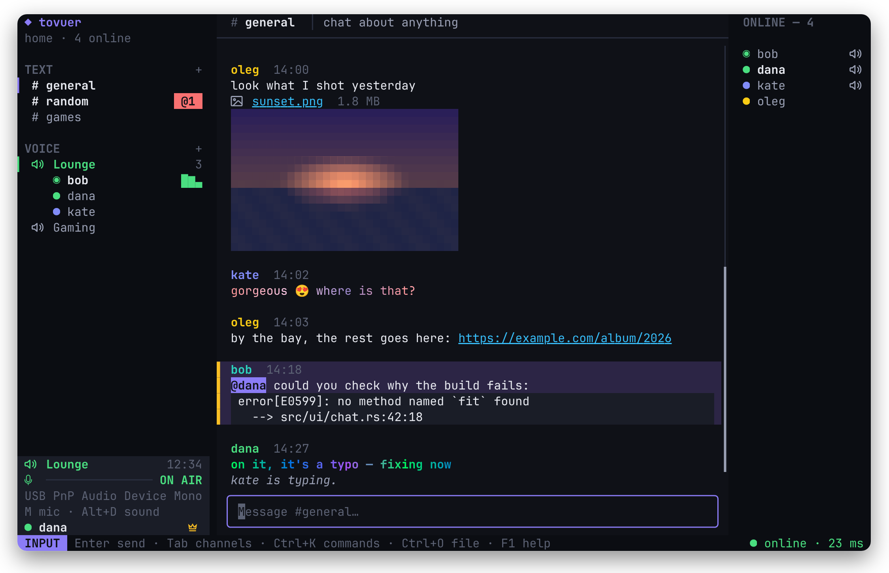
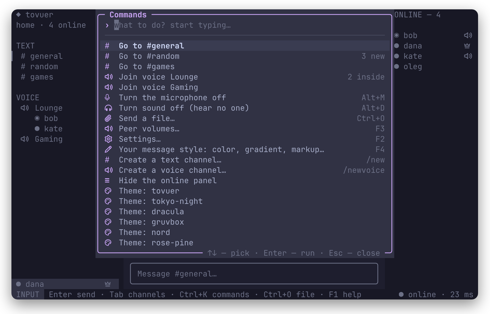
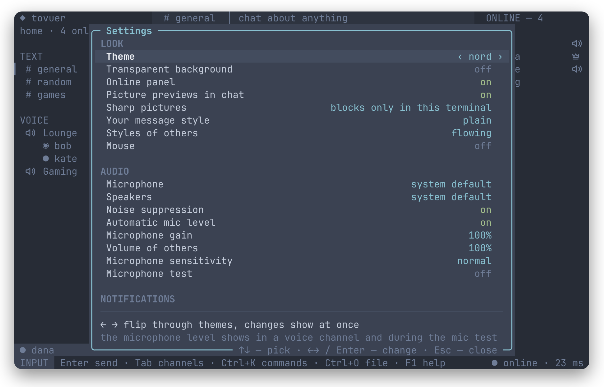
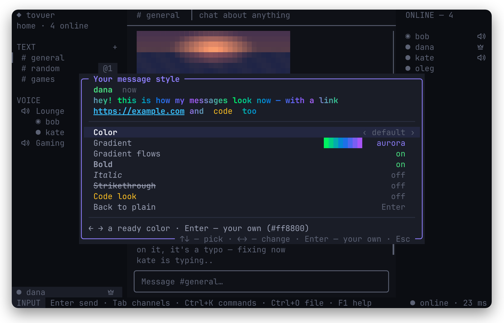
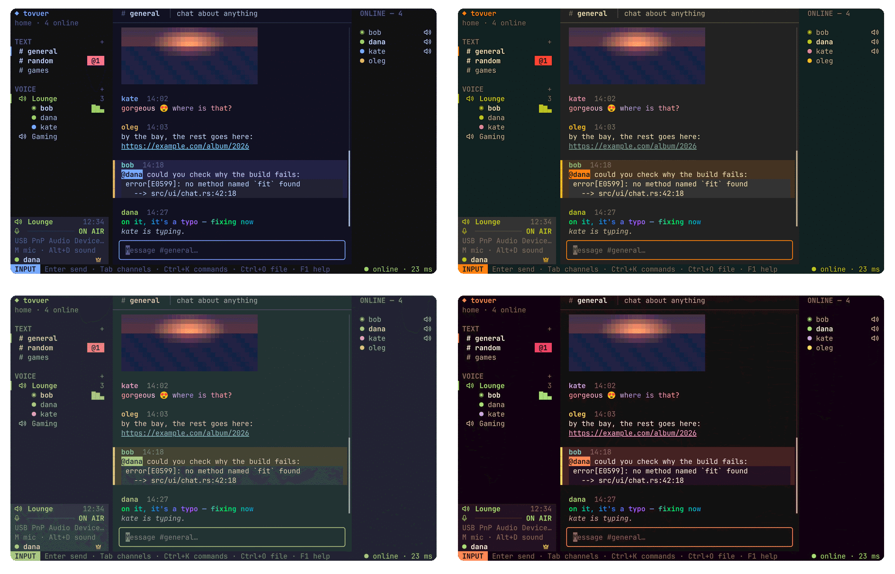

# tovuer

Voice and text chat for your group of friends, right in the terminal — and
with no server. Every person who opens tovuer is a node of the room: they
keep a copy of the history, connect straight to the others and send their
voice directly to the people in the same voice channel. To meet, everyone
just types the same room name (and password). One file, no install, Linux
and Windows.



## What it does

**No server**
- Join by room name: everyone who types the same name and password ends up
  together. Nobody has to run a server, rent a VPS or open ports.
- The load is spread over everyone: each speaker sends their own voice to
  each listener directly (about 4 KB/s per listener while talking).
- The history lives on every member's computer and syncs on its own: whoever
  was offline catches up from whoever is online. Files are handed on by
  anyone who has them.
- Everything is end-to-end encrypted (QUIC); the room's record in the DHT is
  encrypted too.

**Voice**
- Opus 48 kHz, about 4 KB/s per speaker.
- RNNoise noise suppression: fans, room noise and keyboard clatter do not get
  through; the microphone opens on speech, not on loudness.
- Automatic microphone level, per-person volume, local mute.
- An adaptive buffer: 40–60 ms on a good link, growing up to half a second
  over a poor relay and shrinking back; lost packets are concealed.
- Deafen (Alt+D), "who is talking" indicators, a microphone test.

**Chat**
- Replies, editing and deleting your messages, reactions, `@nick` mentions;
  unread marks survive restarts.
- Markup: `**bold**`, `*italic*`, `~~strike~~`, `` `code` ``, code blocks,
  `>` quotes, links, emoji by code (`:fire:` → 🔥).
- Your own message style (`F4`): a color, a gradient that keeps flowing along
  the text (sunset, neon, rainbow… or your own 2–4 colors), and bold /
  italic / strike / code for everything you write. It travels with each
  message, so everyone sees it; colors are kept readable on each reader's
  theme, and anyone can show others' styles still or turn them off.
- Files up to 50 MB, sent byte for byte. Pictures right in the feed and full
  screen. The full-screen viewer draws real pixels where the terminal has
  graphics (Sixel — foot, xterm; Kitty — kitty, Ghostty; iTerm2 — WezTerm),
  colored blocks elsewhere (and on Windows, unless `TOVUER_GRAPHICS=sixel`).
  `o` opens the original in your image viewer, full quality, whatever the
  terminal is.
- Channels on the fly, each with its own topic and draft.

**Interface**
- Command palette (Ctrl+K), settings (F2), a file picker with picture
  previews (Ctrl+O), completion for commands, nicks and emoji.
- 14 themes, including a light one and `terminal` (the terminal's own
  colors); a transparent background; adapts to narrow windows.

## Screenshots

| The command palette (`Ctrl+K`) | Settings (`F2`) |
|---|---|
|  |  |

Your message style (`F4`) — a color or a gradient that keeps flowing, and
markup for everything you write:





The screenshots are the real interface drawn from demo data —
`scripts/screenshots.sh` makes them again.

## Quick start

You need [Rust](https://rustup.rs) 1.91+ and the ALSA headers (`alsa-lib` on
Arch, `libasound2-dev` on Debian/Ubuntu).

```bash
git clone https://github.com/dszhlt/tovuer
cd tovuer
./run.sh install   # build the client and put the tovuer command on your PATH
tovuer             # from any terminal: type a nick, a room name, maybe a password
```

Or without installing: `./run.sh client`, or
`cargo run --release -p tovuer -- --room our-place --name dana`.

The first person to open a room creates it and becomes its **owner** (they
can delete channels and remove people). Everyone else who types the same
name and password joins it.

Pick a name nobody else would — `home` is probably taken by strangers — or
set a password: with a password nobody outside your group can find the room.

## Inviting friends

Simplest: tell them the room name and password and send them the program
(`./run.sh build` makes `target/release/tovuer` and, with `zig` and
`cargo-zigbuild`, `tovuer.exe` for Windows).

Or bake the room in, so friends only type a nick:

```bash
./run.sh friend our-place secret    # → ./tovuer-friend and ./tovuer-friend.exe
```

To hand out new versions, use `./run.sh release our-place secret` instead: it
also puts the builds into your release folder, and while you are online the
members can update with `/update`. (Restart your own tovuer after a release so
the others see the "new version" hint.)

Anyone can put the program on their PATH with `tovuer --install` (Windows:
`.\tovuer-friend.exe --install`) or `/install` inside the client, and then
start it by typing `tovuer`. It goes to `~/.local/bin` (Windows:
`%LOCALAPPDATA%\Programs\tovuer`), no administrator rights needed; if that
folder is not on PATH yet, it is added (`~/.bashrc`, `~/.zshrc`, fish, or the
Windows user PATH) and the command works in a new terminal window.

## How it works, and what to expect

- **Finding each other.** The room name and password give a key; under it
  every member publishes an encrypted note "I am online, here is my address"
  in the public BitTorrent DHT. A newcomer reads those notes, connects to
  anyone it finds, and learns about the rest from them. It also remembers
  everyone it met and tries them first next time. Joining usually takes a few
  seconds.
- **Connecting.** Peers talk over [iroh](https://iroh.computer): QUIC with NAT
  hole punching. When two home routers cannot be punched through, traffic
  goes through the free public relays of n0 — encrypted, they cannot read it.
  Nobody in your group has to run anything.
- **History.** Every change (a message, an edit, a reaction, a channel) is an
  operation signed by its author. Peers exchange the operations the other one
  lacks, so everyone ends up with the same room. If you are alone in the room,
  you can still write: the others get it when you are both online.
- **Owner.** The author of the room's first record. Their deletes and bans
  are honored by everyone; a ban makes all peers stop talking to that person.
  The room is for people you trust: anyone who knows the password is a member.
- **Limits.** Voice is a mesh — every speaker sends to every listener — which
  is great for a group of 2–15, not for a hundred. Someone new can only join
  while at least one member is online. A nick is not reserved; two people
  cannot use the same nick at the same time.

The details are in [protocol.md](protocol.md).

## Keys

| Key | Action |
|---|---|
| `Ctrl+K` | palette: find and run any action |
| `Tab` / `Shift+Tab` | panels: input → channels → messages |
| `Alt+↑` / `Alt+↓` | next channel (also `Ctrl+P` / `Ctrl+N`), `Alt+1…9` — by number |
| `PgUp` / `PgDn` | scroll the feed, `Ctrl+End` — to the latest |
| `Enter` | send; `Alt+Enter` — new line |
| `↑` on an empty line | edit your last message |
| `Alt+M` | microphone (or just `M` on an empty line) |
| `Alt+D` | sound: hear no one and stay silent |
| `Ctrl+O` | send a file (or drop a file into the terminal window) |
| `F1` · `F2` · `F3` | help · settings · peer volumes (`F3` — also `U` on an empty line) |
| `F4` | your message style: color, flowing gradient, bold / italic / strike / code |
| `Ctrl+L` | system log |
| `Ctrl+Q` | quit |

In message mode (`Shift+Tab` from the input): `r` reply, `e` edit, `d` delete,
`a` react, `Enter` open a file or picture, `o` open it in your system's app
(a photo in full quality), `s` save, `y` copy the text. In the picture viewer:
`←`/`→` flip, `o` open the original, `s` save.

In the channel list (`Tab` from the input): `Enter` opens a channel or joins a
voice one, `n` / `v` — new text / voice channel (or click the `+` next to
TEXT / VOICE), `t` — channel topic, `Del` — delete the channel under the
cursor (room owner). The same is in the palette (`Ctrl+K`): "Create a text
channel…", "Delete channel #…".

## Commands

| Command | What it does |
|---|---|
| `/file [path]` | send a file; without a path — the file picker |
| `/files`, `/download <number> [where]`, `/view [number]` | the channel's files, download one, open a picture |
| `/open [number]` | open a file in your system's app — a photo in full quality |
| `/v [channel]` | join a voice channel; without a name — leave |
| `/m`, `/d` | your microphone; sound as a whole |
| `/mute <nick>`, `/unmute <nick>`, `/vol <nick> <0-200>` | mute / unmute / someone's volume — only for you |
| `/volume <0-200>`, `/gain <50-300>` | overall volume; microphone gain |
| `/denoise`, `/agc` | noise suppression and automatic level (`on`/`off`) |
| `/devices`, `/mic [name]`, `/spk [name]` | devices; `/mic` without a name — audio diagnostics |
| `/theme [name\|next]`, `/transparent`, `/previews`, `/sharp`, `/mouse` | looks (`/sharp` — real pixels in the viewer) |
| `/style`, `/color [name\|#rrggbb\|off]`, `/gradient [name\|#hex #hex…\|off]` | how your messages look (`/gradient sunset`, `/color #ff8800`) |
| `/new [name]`, `/newvoice [name]`, `/topic <text>` | create a text / voice channel (without a name — asks), the topic |
| `/delchannel [name]`, `/kick <nick>` | room owner only: delete a text or voice channel (without a name — the open one), remove someone |
| `/me <action>`, `/shrug` | small things |
| `/ping`, `/room`, `/reconnect`, `/log` | the room and diagnostics |
| `/update`, `/install`, `/version`, `/q` | update from the owner, the `tovuer` terminal command, version, quit |

The full list with hints — `F1`, or just start typing `/`.

## Where things are kept

- `~/.config/tovuer/` (Windows: `%APPDATA%\tovuer\`): `settings.json` (theme,
  devices, volumes — change them in `F2`), `state.json` (read marks) and
  `identity.key` — the key others know this install by.
- `~/.local/share/tovuer/` (Windows: `%APPDATA%\tovuer\`): `rooms/` (each
  room's history and the peers you met), `files/` (shared files, by content
  hash — you hand them on to others), `release/` (builds you hand out with
  `/update`).
- `~/.cache/tovuer/`: logs; `open/` — files you opened in another app with
  `o` (cleared at every start).

A build for friends is configured by environment variables at compile time:
`TOVUER_ROOM`, `TOVUER_ROOM_PASSWORD`, `TOVUER_FRIEND=1` (ask only for a
nick), `TOVUER_VERSION`.

## Project layout

```
crates/proto    shared types: chat messages, channels, users, the voice frame
crates/voice    audio: Opus, RNNoise, automatic gain, jitter buffer, devices (cpal)
crates/node     the peer: room keys, signed operation log, DHT lookup, iroh connections
crates/client   the client: logic, interface (ratatui), the link to its own node
```

```bash
./run.sh test                                        # all tests (real nodes over loopback)
./run.sh smoke                                       # two peers find each other over the internet
cargo run -p tovuer --example snapshot -- voice      # the client screen as text, no network
cargo run -p tovuer --example snapshot -- main nord 120 36 shot.html   # the same as HTML with colors
./scripts/screenshots.sh                             # the README screenshots (chromium, ImageMagick, a Nerd Font)
TOVUER_DEBUG=1 tovuer                                # node diagnostics in ~/.cache/tovuer/stderr.log
TOVUER_GRAPHICS=off tovuer                           # pictures as blocks (or force sixel / kitty / iterm2)
TOVUER_ICONS=emoji tovuer                            # emoji icons even with a Nerd Font (or force nerd)
```

Scenes for `snapshot`: `main`, `voice`, `select`, `login`, `palette`, `help`,
`settings`, `users`, `react`, `picker`, `viewer`, `typing`, `toast`.

## License

[MIT](LICENSE).
